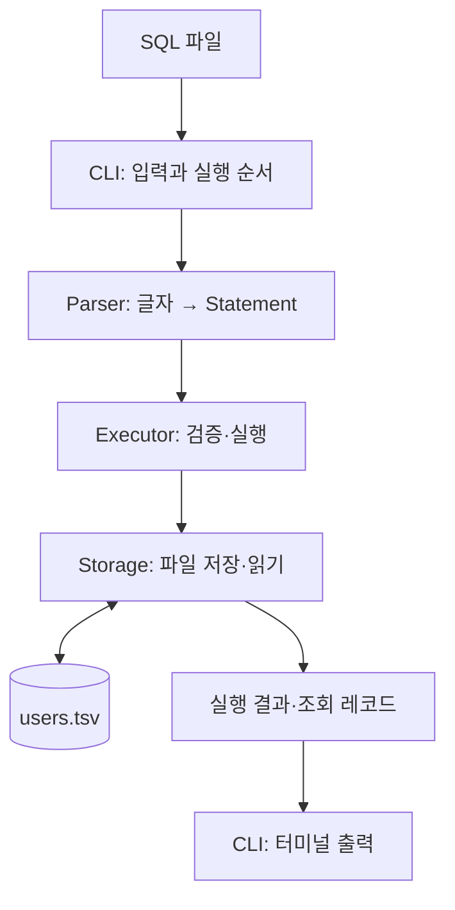

# Phase 1 구현설명서

현재 구현을 위에서 아래로 읽는 지도. 세부 함수는 해당 흐름이 궁금할 때만 내려가서 본다.
DB-P1-02 코드를 기준으로 설명하며, 설명서 작성은 코드 검증 PASS를 뜻하지 않는다.

## 1. 무엇을 만든 건지

SQL 파일로 데이터를 추가하고 조회하는 프로그램이다. 데이터는 users.tsv에 남아서 프로그램을 다시 실행해도 읽을 수 있다.



| 역할 | 코드 | 지금 확인할 것 |
|---|---|---|
| CLI | [main.c](../src/main.c) | 입력을 읽고, 파싱 → 실행을 반복함 |
| Parser | [parser.c](../src/parser.c), [parser.h](../src/parser.h) | SQL의 의미를 Statement에 담음 |
| Executor | [executor.c](../src/executor.c) | INSERT 값 검증, SELECT 조건 검사 |
| Storage | [storage.c](../src/storage.c), [storage.h](../src/storage.h) | 레코드를 파일과 메모리 사이에서 변환 |

## 2. 한 번 실행했을 때

```text
SQL 파일 전체를 메모리에 읽음
  → table_open: 저장 파일 검증·최대 ID 복원
  → parser_next: 한 문장 해석
  → executor_run: 그 문장 실행
  → 다음 문장 해석·실행 반복
  → 파일 닫기·메모리 해제·프로그램 종료
```

전체 SQL을 먼저 파싱하는 건 아님. 파일은 한 번에 읽지만 파싱·실행은 한 문장씩 한다.
‘재실행’은 별도 기능이 아니라 같은 프로그램을 다시 켜는 것임. 기존 파일이 있으면 시작할 때 그 데이터를 읽는다.

## 3. INSERT — 값을 파일에 남기는 경로

```sql
INSERT INTO users (age, name) VALUES (25, '민수');
```

```text
Parser
  parse_insert → parse_columns → parse_values
  컬럼 순서: [COL_AGE, COL_NAME]
  Statement: kind=STMT_INSERT, age=25, name="민수"
    ↓
Executor
  validate_insert: name 포인터·빈 문자열·255바이트·금지 문자, age 0~150 확인
    ↓
Storage
  table_append: 최대 ID + 1 → 텍스트로 기록 → fflush
    ↓
CLI
  print_insert: INSERT 1 출력
```

- `(name, age)`와 `(age, name)`은 컬럼 순서를 배열에 기록해 같은 위치의 값과 연결함.
- 테이블·컬럼 이름과 값 타입은 Parser가 확인하고, Executor는 값의 제약을 확인함.
- id가 메모리에서 int64_t(8바이트 정수)여도 파일에는 숫자를 문자로 바꿔 씀.

최대 ID가 2였다면 저장되는 줄은 다음 형태임. TSV에는 헤더가 없다.

```text
3<TAB>민수<TAB>25<LF>
```

fflush는 C 출력 버퍼를 운영체제로 전달한다. 전원 장애에도 디스크 기록이 남는다는 보장은 아님.

## 4. SELECT — 파일을 읽어서 조건에 맞는 사람 출력

```sql
SELECT * FROM users WHERE age = 25;
```

```text
Parser: parse_select → parse_where
  Statement: kind=STMT_SELECT, where=WHERE_AGE, where_value=25
    ↓
Executor: executor_run
  table_scan에 filter_row 콜백과 조건을 전달
    ↓
Storage: table_scan
  read_line → parse_record → Row를 filter_row에 전달
    ↓
Executor: filter_row → row_matches
  row.age == 25인가?
    맞음 → print_row 호출
    아님 → 출력 없이 다음 레코드
```

위 흐름에서 table_scan 안을 확대한 것이 `read_line → parse_record → 콜백`임. 별개의 읽기 경로가 아니다.

| 파일의 한 줄 | 메모리의 Row |
|---|---|
| `3<TAB>민수<TAB>25<LF>` | id=3, name="민수", age=25 |

**콜백은 ‘한 명 읽었을 때 호출할 함수’를 넘기는 것임.** Storage는 SQL 조건이나 터미널 출력을 몰라도 된다. 읽은 Row를 넘기면 Executor가 조건을 검사하고 CLI가 출력한다.

조건이 없으면 전부 통과하고, ID 조건이면 id를 비교함. 지금은 ID를 찾았어도 끝까지 읽으므로 모든 조회는 선형 탐색 O(N)이다.
CLI는 조회 전에 헤더를 출력해서, 일치하는 데이터가 없으면 헤더만 남는다.

## 5. 시작할 때도 파일을 읽는 이유

```text
table_open → table_scan(t, NULL, NULL, err)
  → 레코드 형식·ID 증가 순서 검증
  → 최대 ID를 Table.last_id에 보관
```

콜백이 NULL이라 출력하지 않는다. 같은 table_scan을 시작 준비와 SELECT에서 재사용하는 것임.
SELECT 파일을 실행하면 시작 준비에서 한 번, 실제 조회에서 한 번 전체 파일을 읽는다.

## 6. 오류와 메모리 — 구분해서 볼 것

| 상황 | 현재 동작 |
|---|---|
| 두 번째 SQL이 잘못됨 | 첫 번째 저장 유지, 두 번째에서 실패, 세 번째 미실행 |
| 같은 SQL 파일 재실행 | 처음부터 실행. 성공했던 INSERT가 다시 추가될 수 있음 |
| 저장 중 I/O 오류 | 실패 보고. 부분 쓰기의 원자적 복구는 보장하지 않음 |
| 프로그램 종료 | 운영체제가 프로세스 메모리 회수. TSV 파일은 유지 |

실행 중 자원은 코드에서도 정리한다.

| 자원 | 수명 |
|---|---|
| SQL 입력 버퍼 | main이 보관하다 free(sql) |
| Statement.name | Parser가 할당, 실행 후 statement_free로 해제. 파싱 실패 경로에서도 정리 |
| Table·파일 | table_open에서 준비, table_close에서 닫고 해제 |
| Row.name | table_scan의 줄 버퍼를 참조. 콜백 중에만 사용, 보관하려면 복사 필요 |

## 7. 이번 구현의 선택과 다음 단계

| 현재 선택 | 한계·아직 없는 기능 |
|---|---|
| 시작 시 전체 파일로 최대 ID 복원 | 데이터가 많으면 시작 시간이 늘어남 |
| 텍스트 파일 순차 조회 | 조건 조회도 전체를 읽음. Phase 2에서 ID B+ 트리 연결 |
| 문장별 실행, 오류 시 CLI 종료 | 자동 이어 실행·전체 취소 없음. 트랜잭션은 미구현 |
| 단일 프로세스 | 동시 요청 제어는 아직 없음. Phase 3에서 다룸 |

이 선택들을 실제 DB 전체의 보편적 동작으로 외우지는 않는다.

## 읽는 순서

1. 실행 결과와 TSV를 비교한다.
2. INSERT 경로(3절)를 본다.
3. SELECT 경로(4절)를 본다. 현재 공부 위치는 여기임.
4. 같은 읽기 함수를 시작 준비에서 어떻게 쓰는지(5절) 붙인다.
5. 메모리·오류 처리는 궁금해진 자원이나 실패 경로 하나씩 확인한다.
