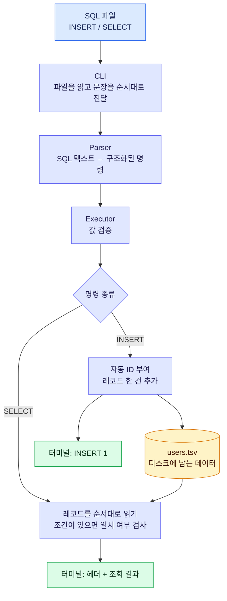
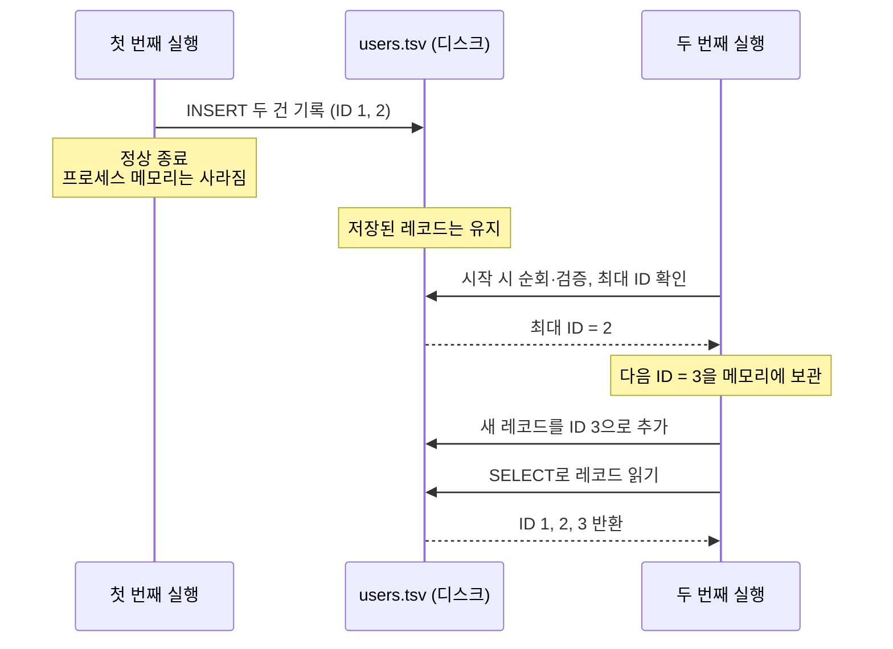
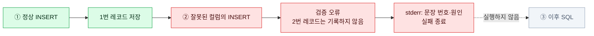

# Phase 1 개발 명세

## 목표와 확정 범위

- [확정: 사용자, 2026-11-12] 언어는 C. Phase 1에 필요한 최소 기능부터 완성한다.
- [과제 요구] SQL 파일을 CLI로 받아 INSERT / SELECT를 실행한다.
- [과제 요구] 테이블별 파일에 저장하고 다시 읽는다. 스키마·테이블은 사전 정의한다.
- [과제 요구] 단위 테스트와 기능 테스트로 검증한다.

아래 스펙은 2026-11-12 사용자가 제안 그대로 승인해 확정했다(DB-D02).

## 한눈에 보는 동작



**SQL은 명령이고, TSV는 저장된 데이터다.** Parser는 명령을 해석하고, Executor와 Storage가 실제 저장·조회를 수행한다. 오류 흐름은 아래에서 별도로 본다.

## 입출력 계약

```text
miniDBMS --data-dir ./data ./examples/basic.sql
```

| 항목 | 동작 |
|---|---|
| 입력 | UTF-8 SQL 파일 하나. 세미콜론으로 구분된 여러 문장을 순서대로 실행 |
| 테이블 | users 하나. id: 양의 64비트 정수, name: 문자열, age: 0~150 정수 |
| INSERT | name, age 컬럼을 각각 한 번 명시. 순서 변경 허용. 한 문장에 한 레코드 |
| ID | 사용자 입력 금지. 1부터 자동 부여. 재실행 시 기존 최대 ID 다음부터 시작 |
| SELECT | 전체 컬럼 조회. 선택적으로 id 또는 age에 정수 동등 조건 하나 |
| 결과 | INSERT는 `INSERT 1`, SELECT는 아래 TSV 형식. 결과 없음은 헤더만 출력 |
| 오류 | stderr에 문장 번호와 원인. 즉시 종료. 성공 종료 코드 0, 실패는 0 이외 |
| 저장 | 첫 실행은 빈 테이블로 시작. 정상 종료 후 재실행해도 데이터 유지 |

```sql
INSERT INTO users (name, age) VALUES ('민수', 25);
INSERT INTO users (age, name) VALUES (30, 'O''Brien');
SELECT * FROM users;
SELECT * FROM users WHERE id = 1;
SELECT * FROM users WHERE age = 30;
```

전체 조회 출력 예시(컬럼 구분은 탭):

```text
id	name	age
1	민수	25
2	O'Brien	30
```

## SQL 지원 경계

- 키워드·테이블·컬럼 이름은 대소문자 무시. 문자열 값은 보존한다.
- 공백·탭·개행과 여러 줄 SQL 허용. 빈 파일은 성공한다.
- 문자열은 작은따옴표로 감싼다. 내부 작은따옴표는 `''`. 문자열 안의 세미콜론은 구분자가 아니다.
- name은 UTF-8 기준 1~255바이트. 탭·CR·LF·NUL은 금지. UTF-8 유효성 검사는 범위 밖이다.
- 세미콜론은 필수. 정수 범위 초과, 누락·중복·미지원 컬럼, 잘못된 타입은 오류다.
- 조회 순서는 삽입 순서. Phase 1의 모든 조건 검색은 선형 탐색한다.
- INSERT 문장 검증이 끝난 뒤 기록한다. 뒤 문장 실패 시 앞서 성공한 INSERT는 유지한다.
- 저장 파일 손상·읽기·쓰기·닫기 실패는 오류로 보고한다. I/O 실패 시 원자적 복구는 보장하지 않는다.

## 제외

CREATE TABLE, UPDATE, DELETE, NULL, SQL 주석, 컬럼 선택 조회, 복합 조건,
JOIN, 정렬, 트랜잭션, 동시 실행, B+ 트리, API, 비정상 종료·전원 장애 복구.

## 종료해도 데이터가 남는 이유



파일에는 레코드를 보관하고, 다음 ID는 실행할 때 복원한다. 정상 종료·재실행 시나리오이며 전원 장애 복구는 포함하지 않는다.

## 문장 중간에 실패하면



앞서 성공한 ①은 유지된다. 전체 SQL 파일을 하나의 트랜잭션으로 되돌리지는 않는다. 이 그림은 검증 오류 예시이며, 쓰기 도중 I/O 실패의 원자적 복구는 보장하지 않는다.

## 완료 시나리오

아래는 Phase 1 전체 완료 기준이다. 1단위는 기본 저장·조회, 2단위는 조건 검색·전체 검증이며 자세한 구분은 [구현 순서](tasks.md)를 따른다.


| ID | 확인 |
|---|---|
| A1 | SQL 파일로 2건 추가 후 전체 조회: 값·ID·순서 일치 |
| A2 | id / age 조건: 일치·불일치·여러 건 일치 결과 확인 |
| A3 | 종료 후 다시 조회하고 추가: 데이터 유지, ID 3 부여 |
| A4 | 한글·작은따옴표·문자열 안 세미콜론·여러 줄 SQL 처리 |
| A5 | 잘못된 SQL·컬럼·타입·범위: 실패 종료, 실패 INSERT 미저장 |
| A6 | 두 번째 문장 실패: 첫 번째 저장 유지, 세 번째 미실행 |
| A7 | 빈 파일·빈 테이블·없는 SQL 파일·손상된 데이터 파일·I/O 오류 처리 |
| A8 | 단위·CLI 테스트 통과. 사용한 검사 도구로 메모리 오류·누수 확인 |
